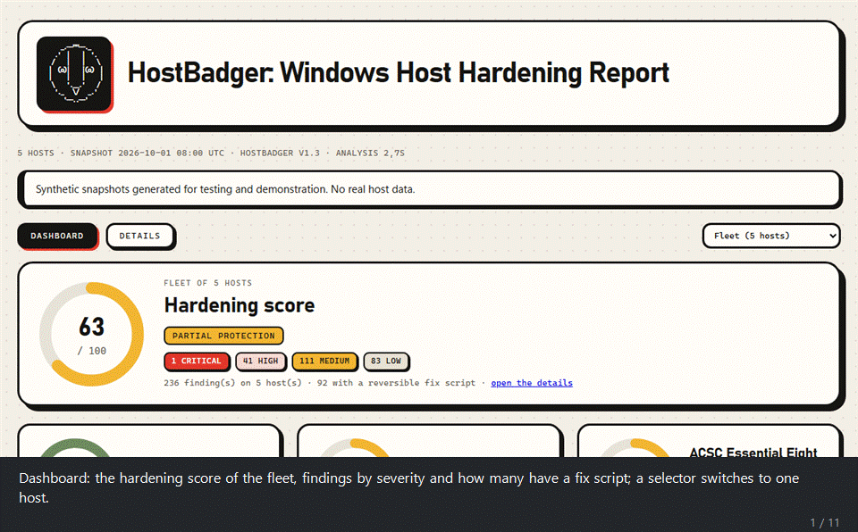

```
     _.--""--._
   .'  |    |  '.
  /    |    |    \      HostBadger
 |  (o)|    |(o)  |     Windows host hardening
 |     |    |     |
  \    '.__.'    /
   '._   \/   _.'
      '--..--'
```

[](LICENSE) [](https://www.bestpractices.dev/projects/15495)



## Summary

HostBadger audits the security settings of Windows machines and tells you what
is weak. It works in two steps. A single PowerShell script takes a
**read-only snapshot** of a host. The analyzer then reads the snapshots
**offline** and writes an HTML report, a findings CSV and, if you want it, JSON
Lines for a SIEM. Hand it one snapshot or a folder with hundreds and you get
the whole fleet in one report, or one report per host.

- **132 checks** and about 1,548 settings: 120 hand-written checks plus 1427 DISA
  STIG registry rules, with the CIS Windows 11 benchmark as the baseline, and
  the drivers matched against 2,198 known vulnerable or malicious driver files
  (LOLDrivers).
- **Collect anywhere, analyze anywhere**: the collector is one `.ps1` file made
  to run as SYSTEM through an EDR (CrowdStrike Falcon RTR or any tool that runs
  scripts) on many hosts in about 15 seconds.
- **Read only**: it changes nothing and starts nothing, and it makes no network
  call unless you ask for one: `-CheckUpdates` (the Windows Update service
  searches for missing updates), `-KevOnline` (downloads the CISA KEV catalog,
  www.cisa.gov), `-DriversOnline` (downloads the LOLDrivers catalog,
  www.loldrivers.io), `-EolOnline` (downloads software lifecycle data,
  endoflife.date), `-ChocoOnline` (downloads program versions,
  community.chocolatey.org), `-CveOnline` (downloads CVEs and EPSS scores,
  services.nvd.nist.gov and epss.empiricalsecurity.com) and `-SendToAI` (Gemini). Each one is named where it is offered.
  `Test-HostBadgerSafety.ps1` proves the rest from the code.
- **Honest about gaps**: what could not be read is listed as *not evaluated*,
  never as clean.
- **Nothing to install**: Windows PowerShell 5.1 or PowerShell 7.
- **Windows 10, Windows 11 and Windows Server**: every host gets the general checks and the STIGs of Defender, Firewall, Edge, Chrome, Firefox and Office (when installed); a Windows 10 host also gets the Windows 10 STIG and a Windows 11 host the Windows 11 STIG. The CIS rule numbers are those of the host's own benchmark: Windows 11, Windows 10, Windows Server 2022, 2019 or 2016 (other versions keep the Windows 11 numbers). A Windows Server 2016, 2019, 2022 or 2025 host gets its own STIG, the domain controller or the member server rules by role (other server versions get no Windows STIG); its user rights are judged against the member server or domain controller list of the CIS Server benchmark.

It reads what a host actually *does*, which is not always what policy says it
should.

## Features

### Security areas

- **Credential protection**: LSASS protection, Credential Guard, memory
  integrity (HVCI), WDigest, cached logons, LM/NTLM settings, anonymous access.
- **Microsoft Defender and EDR**: real-time protection, tamper protection,
  signatures, exclusions, PUA, Network Protection, behavior monitoring, cloud
  protection, the 3 standard and 13 more attack surface reduction rules, and
  which EDR agent each host runs.
- **Disk and boot**: BitLocker on system and data volumes, TPM-only protectors,
  Secure Boot.
- **Network exposure**: SMB and LDAP signing, SMBv1, LLMNR, NetBIOS, firewall
  profiles and logging, risky listeners, legacy SSL/TLS protocols and weak
  ciphers.
- **Remote access**: RDP, NLA and RDP policy, WinRM authentication.
- **Local accounts and UAC**: built-in accounts, local administrators, LAPS,
  password and lockout policy, user rights, UAC settings.
- **Privilege escalation**: writable service and task programs, unquoted
  paths, AlwaysInstallElevated, autoruns, Point and Print (PrintNightmare).
- **Logging and audit**: advanced audit policy, command-line auditing,
  PowerShell script block, module and transcription logging, log sizes.
- **Patching and lifecycle**: Windows update age, end of support and, if you
  ask for it (`-CheckUpdates`), the updates that Windows Update reports as
  missing, rated by Microsoft severity.
- **Installed software**: the Programs and Features list of every host, shown in
  the report with pie charts by publisher; with the CISA KEV catalog (`-KevFile`
  or `-KevOnline`) each program that matches a product with vulnerabilities
  known to be exploited becomes a lead to verify (the catalog has no version
  ranges, so the match is by vendor and product name only). Releases past
  their end of support (Flash, Java 6/7, old Office, Exchange and SQL Server,
  Python, Node.js, .NET, old Visual C++ runtimes) are flagged from a lifecycle
  table, no download needed. With `-EolOnline` (or `-EolFile`) the dates come
  from [endoflife.date](https://endoflife.date) (MIT), which adds Oracle Java, Eclipse Temurin,
  PowerShell 7, VirtualBox and Wireshark, judges each SQL Server instance on its
  service pack and its latest cumulative update or GDR build (read from the
  engine file `sqlservr.exe`), and flags programs behind the latest
  release of their line (`software_outdated`: Python 3.12.1 when 3.12.9 has been
  out for months, a Firefox, Chrome or Notepad++ that stopped updating). A
  release counts only if it came out before the snapshot and more than
  `-SoftwareGraceDays` (30) earlier. With `-ChocoOnline` (or `-ChocoFile`) the
  same check covers 7-Zip, VLC, Git for Windows, GIMP, WinSCP, PuTTY, FileZilla,
  KeePass, Audacity, Mullvad VPN, OBS Studio and AnyDesk, from the versions and
  publication dates of their Chocolatey community packages (the same list is
  asked for whatever the hosts have, so the requests say nothing about them).
  With `-CveOnline` (or `-CveFile`) `software_cve` lists the known
  vulnerabilities of the installed version of Python, Node.js, .NET, Notepad++,
  PowerShell 7, VirtualBox, Wireshark, 7-Zip, VLC, Git, GIMP, WinSCP, PuTTY,
  FileZilla, KeePass, Audacity, Mullvad VPN and AnyDesk: the CVEs of each
  product come from the [NVD](https://nvd.nist.gov) CVE API (asked for by
  product, never by version) and their version ranges are judged locally; each
  finding gives the count, the highest CVSS score, the CVEs in CISA KEV and the
  highest [EPSS](https://www.first.org/epss/) score (probability of
  exploitation), and names the release that fixes them all. NVD has a backlog
  of CVEs without version data, so the newest ones can be missing. About 2.5
  minutes without an NVD API key (`NVD_API_KEY` makes it faster).
- **Vulnerable and malicious drivers**: the SHA-256 of every kernel driver file
  is matched against the [LOLDrivers](https://www.loldrivers.io) catalog
  (Apache License 2.0) of drivers used in "bring your own vulnerable driver"
  attacks. A known malicious driver is Critical, a loaded vulnerable one High.
  The match is by exact hash, so a fixed version of the same driver does not
  match. A copy of the catalog ships in `data\vulnerable-drivers.json`
  (rebuilt by `tools\Convert-LolDrivers.ps1`); `-DriversOnline` downloads a
  fresh one. The Microsoft vulnerable driver blocklist turned off is a finding
  too.
- **System hardening**: autoplay, automatic logon, screen lock, SmartScreen and
  the other CIS Windows 11 baseline settings.

### Compliance

- **DISA STIG, 1427 registry rules** across twelve products, one finding per
  rule that differs (a setting that is not configured counts, as the STIG
  asks):

  | Product | STIG release | Rules |
  |---|---|---|
  | Windows 10 | V3R6 | 137 |
  | Windows 11 | V2R7 | 133 |
  | Windows Server 2025 (domain controller / member server) | V1R1 | 94 / 94 |
  | Windows Server 2022 (domain controller / member server) | V2R8 | 99 / 102 |
  | Windows Server 2019 (domain controller / member server) | V3R8 | 98 / 102 |
  | Windows Server 2016 (domain controller / member server) | V2R10 | 98 / 102 |
  | Microsoft Defender Antivirus | V2R8 | 67 |
  | Windows Defender Firewall | V2R2 | 38 |
  | Microsoft Edge | V2R5 | 53 |
  | Google Chrome | V2R11 | 40 |
  | Mozilla Firefox | V6R7 | 43 |
  | Microsoft Office 365 ProPlus | V3R5 | 127 |

  Severity follows the STIG category (CAT I High, CAT II Medium, CAT III Low).
  A server gets the domain controller or the member server rules of its
  version, by role. Browser and Office rules apply only when the product is installed, and
  Office rules are per-user policies, judged on the user profiles loaded when
  the snapshot was taken. Rules that need an organization decision (a banner
  text, an approved URL list) are not judged. The data comes from the
  processed files of [Microsoft PowerSTIG](https://github.com/microsoft/PowerSTIG)
  (MIT) and the DISA releases; `tools\Convert-PowerStigData.ps1` rebuilds it.
- **CIS Windows 11 Enterprise benchmark v3.0.0**: rule numbers in the findings,
  taken from the MIT-licensed
  [ansible-lockdown/Windows-11-CIS](https://github.com/ansible-lockdown/Windows-11-CIS)
  role. On Windows 10 and on Windows Server 2022, 2019 and 2016 the same
  findings quote the rule of that version's CIS benchmark (Windows 10
  Enterprise v3.0.0, Server 2022 and 2019 v4.0.0, Server 2016 v3.0.0; domain
  controller or member server variant), from `data\cis-map.json`.
- **Compliance charts** at the top of the report: how much of the STIG and of
  the CIS-based checks the hosts meet. `-HideCis` and `-HideStig` take those
  findings out of the report listing (the CSV and JSON Lines keep them) and
  `-SkipStig` leaves the STIG rules out altogether.
- `COVERAGE.md` lists every check with its severity, MITRE technique, CIS rule
  and whether a fix script exists.

### Reporting and fixing

- **HTML report** with scores per host (A to F), pie charts (severity,
  category, grades, compliance, software, and local accounts: enabled
  administrators versus standard users and disabled accounts), findings grouped
  by check, a fix script under each fixable check, filters and a
  *not evaluated* section; **CSV** and **JSON Lines** for a SIEM with stable
  finding ids. Every CIS and STIG finding shows the value **found** on the
  host next to the value the framework **requires** (for example found "not
  configured", required "1"), in the report table, the CSV and the JSON Lines.
  Every check also says **what an attacker can do with it** ("Attacks it
  enables": NTLM relay to SMB, credential dumping, privilege escalation to
  SYSTEM...), in the report, the `Attacks` CSV column and the `attacks` JSON
  Lines field.
- **One report per host** with `-PerHost`, or one fleet report.
- **Comparison with an earlier run** (new and resolved findings) and **accepted
  risks** with an owner and an expiry.
- **Remediation scripts** (`-OutRemediation`): one setting, the expected value,
  previewed by default, with a rollback file. HostBadger never runs them.
- **Optional AI summary** with Gemini: host names, accounts, paths and
  addresses are replaced by tokens first and a leak check refuses to send if
  one survives. You choose whether the STIG findings go too (there can be
  hundreds per host, and a prompt that large may time out).
- **Guided menu** (`Start-HostBadger.ps1`) for collecting, analyzing, the AI
  step and the safety review.


## How it compares

HostBadger sits next to the tools below, not in place of them. The table is a
summary of their public documentation as of October 2026: check the vendors'
own pages before relying on it, especially for licensing and editions.

| | HostBadger | HardeningKitty | Microsoft Policy Analyzer (SCT) | DISA SCC | CIS-CAT Pro | Tenable Nessus / Qualys Policy Compliance | Microsoft Defender Vulnerability Management |
|---|---|---|---|---|---|---|---|
| License | MIT, free | MIT, free | Free | Free | Commercial (CIS SecureSuite) | Commercial | Commercial (Defender for Endpoint / add-on) |
| Focus | Windows host hardening | Windows host hardening | GPO and local policy against Microsoft baselines | DISA STIG through SCAP | CIS benchmarks | Vulnerabilities and compliance, many platforms | Endpoint vulnerabilities and configuration |
| CIS benchmarks | Yes: Windows 10/11 and Server 2016-2022 rule numbers | Yes: Windows 10/11, Server 2012 R2-2025 lists | No (Microsoft baselines) | No | Yes, full | Yes | Add-on |
| DISA STIG | Registry rules only (1,427, twelve products) | Some lists (Windows 10, Server 2019, Defender, Firewall) | No | Yes, full SCAP content | Check with CIS | Yes | Add-on |
| Microsoft security baselines | Partly, through CIS/STIG overlap | Yes | Yes | No | No | Yes | Yes |
| Software and vulnerabilities | End of support, behind latest release, CVEs by installed version with CVSS, KEV and EPSS (about 20 mapped products), vulnerable drivers | No | No | No | No | Yes, full CVE scanning | Yes |
| Collection | One read-only script, also through an EDR | Run on the host | Local or exported GPOs | Local or remote | Local or remote | Agent or credentialed scan | Defender sensor |
| Offline analysis of saved snapshots | Yes | No | Yes (GPO backups) | No | No | No | No (cloud) |
| Fleet report | HTML, CSV, JSON Lines | Per host (CSV) | Per comparison | Per host | Yes | Console | Console |
| Value found next to value required | Yes | Yes | Yes | Yes | Yes | Yes | Partly |
| Fixes | Reversible scripts with rollback, never run by the tool | Can apply the settings (HailMary), GPO export | No | No | No | No | Recommendations |
| AI summary | Optional (Gemini), names tokenized and a leak check before anything is sent | No | No | No | No | Vendor cloud AI, licensed separately | Microsoft Security Copilot, licensed separately |
| What the code can do, checked from the code | Yes (`Test-HostBadgerSafety.ps1`) | No | No | No | No | No | No |

**When to use something else (or as well):**

- **A vulnerability scanner** (Tenable, Qualys, Rapid7, Defender Vulnerability
  Management) for CVEs by installed version, third-party patch status across
  thousands of products and a central console. HostBadger judges CVEs, end of
  support and missed releases only for the products it maps (about twenty
  common programs plus the Windows and lifecycle checks).
- **DISA SCC** when the STIG result is the deliverable (an ATO, an audit): it
  runs the full SCAP content, including the rules that are not registry values.
  HostBadger judges the registry rules only.
- **CIS-CAT Pro** when you need the CIS assessment itself (certified results,
  every benchmark section, other platforms).
- **HardeningKitty** to apply a hardening list on a host or build a GPO from
  it, or for the Microsoft security baselines and BSI lists. HostBadger never
  changes a setting.
- **Policy Analyzer** to compare Group Policy objects before they are deployed.
  HostBadger reads what the host actually does, not what the GPO says.
- **PingCastle** (or similar) for Active Directory itself. HostBadger looks at
  each host, including domain controllers, not at the directory.

## The pieces

| Script | Runs on | Needs | Produces |
|---|---|---|---|
| `Collect-HostSnapshot.ps1` | each Windows host | SYSTEM or a local administrator (a standard user works, with gaps) | `hostsnapshot_<host>_<time>.zip` |
| `HostBadger.ps1` | anywhere | nothing (a Gemini key only for the optional AI step) | HTML, CSV and JSONL report for one host or a fleet |
| `Start-HostBadger.ps1` | anywhere | nothing | a menu that runs the collector and the analyzer for you |
| `Test-HostBadgerSafety.ps1` | anywhere | nothing | proof, read from the code, that the collector only reads |

It runs on Windows PowerShell 5.1 or PowerShell 7, and there is nothing to
install.

If you are not sure where to start, run `.\Start-HostBadger.ps1`. It is a
small menu: collect this machine, analyze a file, a zip or a folder, add an AI
summary, run the safety review. When you analyze, it looks for snapshots by
itself (in a `snapshots` folder, then in the current folder) and lets you take
them all or pick one by number.

## Quick start

On one host, as administrator:

```powershell
.\Collect-HostSnapshot.ps1                       # C:\Windows\Temp\HostBadger\hostsnapshot_<host>_<time>.zip
.\HostBadger.ps1 -Snapshot C:\Windows\Temp\HostBadger -OutHtml report.html
```

On many hosts through CrowdStrike Real Time Response (upload
`Collect-HostSnapshot.ps1` as a cloud script first):

```text
runscript -CloudFile="Collect-HostSnapshot" -Timeout=600
get C:\Windows\Temp\HostBadger\hostsnapshot_<host>_<time>.zip
```

Or with PSFalcon on a host group, and then analyze all the zips together:

```powershell
Invoke-FalconRtr -Command runscript -Argument '-CloudFile="Collect-HostSnapshot" -Timeout=600' -GroupId <id>
# fetch the zips (get / Invoke-FalconRtr -Command get), then:
.\HostBadger.ps1 -Snapshot .\snapshots\ -OutHtml fleet.html -OutJsonl fleet.jsonl
```

If a host has several snapshots, the newest one wins.

For a fleet, add `-PerHost` to get one report per host next to the fleet report
(`fleet_<HOST>.html`, each with only that host's findings). The guided menu
(`Start-HostBadger.ps1`) offers it, on by default, whenever the folder holds
snapshots of more than one host.

### Encrypted snapshots

A snapshot describes the host in detail, and it waits in a temp folder and in
the EDR's file store. The collector can encrypt it: the output is then
`hostsnapshot_<host>_<time>.hbx`, the zip is built in memory, and nothing is
written in clear. Two ways:

```text
# A password: AES-256 with an HMAC-SHA256, keys from PBKDF2 (600,000 rounds of SHA-256).
runscript -CloudFile="Collect-HostSnapshot" -CommandLine="-EncryptPassword 'long passphrase'" -Timeout=600

# A certificate (CMS, AES-256): only its public key is needed on the host, as a .cer file
# put there first, or the thumbprint of a certificate deployed to the machine store.
runscript -CloudFile="Collect-HostSnapshot" -CommandLine="-EncryptCertificate C:\Windows\Temp\hostbadger.cer" -Timeout=600
```

A password given on a command line is kept in the EDR's command history; a
certificate leaves no secret on the host or in any log, so it is the better
choice for a fleet. HostBadger.ps1 reads `.hbx` files like zips: it asks for
the password (or takes `-SnapshotPassword`, a SecureString), and opens a
certificate snapshot with the private key from the certificate store or from
`-SnapshotPfx` (its password is asked for, or `-SnapshotPfxPassword`). A wrong
password or a changed file is reported and that snapshot is skipped. The guided
menu asks for encryption when it collects, a password by default. Deriving the
key takes about 3 seconds per snapshot on Windows PowerShell 5.1 (well under one
on PowerShell 7).

### If PowerShell won't run the scripts

On many machines Windows PowerShell refuses to run `.ps1` files, because the
execution policy is Restricted, AllSigned or RemoteSigned. You don't have to
change the policy of the machine. Start the script in a PowerShell process that
skips the policy, for that run only:

```powershell
powershell.exe -NoProfile -ExecutionPolicy Bypass -File .\Start-HostBadger.ps1
powershell.exe -NoProfile -ExecutionPolicy Bypass -File .\HostBadger.ps1 -Snapshot .\snapshots\ -OutHtml fleet.html
powershell.exe -NoProfile -ExecutionPolicy Bypass -File .\Collect-HostSnapshot.ps1     # from an elevated window
```

With PowerShell 7 it is the same, with `pwsh` instead of `powershell.exe`. In a
window that is already open you can also run
`Set-ExecutionPolicy -Scope Process -ExecutionPolicy Bypass`, which lasts until
you close the window.

A few things worth knowing:

- `-ExecutionPolicy Bypass` applies to that one process and changes nothing on
  the machine. `Get-ExecutionPolicy -List` shows which policy is in force.
- If Group Policy sets the policy (it shows as MachinePolicy or UserPolicy in
  that list), the flag can't override it. Ask whoever manages the policy, or
  have the scripts signed.
- Files that come from the internet carry a "downloaded" mark, and Windows can
  ask about them or block them. After you extract the zip, run
  `Get-ChildItem .\HostBadger -Recurse -Filter *.ps1 | Unblock-File`. You can
  also unblock the zip itself before extracting (right-click, Properties,
  Unblock).
- Through EDR Real Time Response none of this applies, because the platform
  runs the cloud script itself.
- The execution policy is a safety net against accidents, not a security
  boundary. Before you run anything as administrator, see what the scripts can
  do with `.\Test-HostBadgerSafety.ps1`.

### Domain-joined hosts

Run the collector on a domain member, a member server or a domain controller
the same way as on a standalone machine, elevated or as SYSTEM. What to expect:

- The collector reads the local state only. It makes no LDAP query and no call
  to a domain controller, and it never enumerates domain users or groups.
- The role (workstation, server, domain controller) comes from
  `Win32_ComputerSystem.DomainRole` and decides which checks apply. The
  snapshot also records whether the host is part of a domain.
- Domain accounts and groups in the local Administrators group are listed with
  their SID and a `DOMAIN/Name` path. Use that form in `-AllowedAdmins`.
- Settings pushed by Group Policy are seen as the values in force on the host
  (registry, `secedit`, `auditpol`), not as GPO objects.
- A GPO can set the execution policy (see above), and AppLocker or WDAC can
  block the script. A section that fails, for instance for lack of rights, is
  recorded in `meta.collectionErrors` and its checks are listed as not
  evaluated.
- The snapshot holds real host, domain and account names. Keep it out of the
  repository.

## What HostBadger checks

| Area | Checks | What's in it |
|---|---|---|
| Credential Protection | 12 | LSASS protection (RunAsPPL), Credential Guard, WDigest cleartext, cached logons, LM hash storage, LM/NTLMv1, anonymous SAM enumeration. From the CIS baseline: NTLM session security, anonymous share enumeration, Everyone includes anonymous, PKU2U and NULL session fallback, automatic logon (High when the password is stored). |
| Antivirus and EDR | 11 | Defender real-time protection, tamper protection, signature age, every exclusion (High when it is broad or writable by users: a drive, a profile, Temp, a script extension, powershell.exe), Microsoft's three standard ASR rules. From CIS: Network Protection, PUA blocking, SmartScreen. EDR agents: one that is installed but stopped (High), the one you expect missing (High), no known EDR at all (Low on a workstation, Medium on a server). |
| Disk and Boot | 4 | BitLocker on the OS volume (High on workstations), TPM without a PIN on laptops, fixed data volumes, Secure Boot and legacy BIOS. |
| Network Exposure | 17 | SMBv1, SMB signing on server and client, LLMNR, NetBIOS, firewall profiles that are off or allow everything in, dropped packet logging, risky listeners (Telnet, FTP, TFTP, SNMP, VNC, databases, caches, WinRM over HTTP on workstations). From CIS: insecure SMB guest logons, LDAP client signing, anonymous shares and pipes, the domain secure channel, clear-text SMB passwords, WinRM Basic, Digest and unencrypted traffic, the SMBv1 client driver, IP source routing and ICMP redirects. |
| Remote Access | 3 | RDP without NLA, RDP on workstations. From CIS: RDP security layer, encryption, password prompt, drive redirection. |
| Local Accounts | 15 | The built-in Administrator, Guest, extra members of local Administrators, accounts that may have an empty password, passwords that never expire, LAPS (Windows or legacy), UAC off or silent, LocalAccountTokenFilterPolicy. From CIS: blank passwords over the network, ForceGuest, UAC secure desktop and the other UAC options, the local password and lockout policy, Guests and local accounts denied remote logon. |
| Privilege Escalation | 7 | Services, privileged scheduled tasks and machine-wide autoruns whose program (High) or folder (Medium) can be written by low-privileged users, unquoted service paths, AlwaysInstallElevated, Print Spooler on DCs. From CIS: user rights held by more principals than the Level 1 baseline allows, with the member server and domain controller lists on servers (debug, act as part of the OS, load drivers and a few more are High). |
| Logging | 7 | The 16 audit subcategories the CIS benchmark expects (matched by GUID, so any language works), command lines in event 4688, PowerShell script block logging, the PowerShell 2.0 downgrade engine, Security log size. From CIS: Application and System log size, PowerShell transcription. |
| Patching | 4 | A Windows build and edition that is out of support or about to be, no Windows update installed within the threshold, Automatic Updates turned off by policy. |
| System Hardening | 7 | All from CIS: AutoPlay and AutoRun, inactivity lock, logon message, last user shown, SEHOP, safe DLL search, and the services the baseline wants disabled (workstations). |

[`COVERAGE.md`](COVERAGE.md) has the full list with severity, MITRE technique,
CIS rule and whether the check comes with a fix script.

Checks know the role of the host (workstation, server or domain controller).
Credential Guard and cached logons don't apply to DCs, and the Print Spooler
check applies only to them. SMB signing is High on a DC and Medium elsewhere.
An unencrypted OS volume is High on a workstation and Medium on a server.

### EDR agents

HostBadger reads the list of services, which the collector already collects,
and recognises the agents of the well-known EDR and endpoint protection
products: CrowdStrike Falcon, SentinelOne, Microsoft Defender for Endpoint,
VMware Carbon Black, Palo Alto Cortex XDR, Sophos Intercept X, Trend Micro
(Apex One and Deep Security), Trellix / FireEye / McAfee ENS, ESET, Symantec /
Broadcom, Elastic Defend, Cybereason, Cylance, Bitdefender GravityZone and
Huntress. The Hosts table of the report and the `host_summary` lines of the JSON
Lines say which one each host runs.

- An agent that is installed but whose service is not running is **High**. The
  host is blind, and a stopped agent is what an attacker leaves behind.
- With `-ExpectedEdr CrowdStrike` (or several names), a host that doesn't have
  that product is **High**. This is the check that matters in practice, because
  it finds the hosts that your SOC doesn't see.
- Without it, a host with no known EDR at all is reported: Low on a
  workstation, Medium on a server or a domain controller. Microsoft Defender
  Antivirus alone doesn't count as EDR. Defender for Endpoint counts once it is
  onboarded, which is when its `Sense` service runs.

A product is found by the name of its main service, or by the display name of a
service. If yours isn't recognised, name its service with
`-ExtraEdrServices MyAgentService`. `-ExpectedEdr` also takes any other text,
which is then looked for in the service names.

The service names come from the vendors' documentation and common practice, and
vendors rename them between versions. If a host that runs an EDR is reported as
having none, compare its service name with the list in `lib\Checks.ps1`
(`$script:EdrProducts`) and add it with `-ExtraEdrServices`. HostBadger doesn't
check that an agent is healthy, up to date or talking to its console. It only
knows that a service is there and running.

### The CIS baseline

34 of the checks follow a rule from the *CIS Microsoft Windows 11 Enterprise
Benchmark v3.0.0*. The rule number shows up in the finding, in the report and
in the `cis` field of the JSON Lines.

Most of them read registry values and nothing else. They judge a value only
when it is set, with a few exceptions where the Windows default is itself the
problem (AutoPlay, the logon screen, the inactivity lock, the anonymous share
restriction).

HostBadger is not a CIS conformance scanner. The benchmark has several hundred
rules and HostBadger reads a part of them. It covers the local password and
lockout policy and the Level 1 user rights, but only a few of the
administrative templates.

Windows 10, servers and domain controllers have their own benchmarks, with
other rule numbers. On Windows 10 a finding quotes the *CIS Microsoft Windows 10
Enterprise Benchmark v3.0.0*; on Windows Server 2022 and 2019 the *CIS
Microsoft Windows Server 2022 / 2019 Benchmark v4.0.0*, on Server 2016 the
*v3.0.0* of its benchmark: the domain controller or the member server variant,
by the host's role, with that benchmark's profile level. Other versions
(Windows Server 2025, 2012 R2) keep the Windows 11 numbers. The
`cis_benchmark` field of the JSON Lines (and the `CisBenchmark` column of the
CSV) names the benchmark. The expected values the checks use are the same in
these benchmarks for every setting HostBadger reads; one exception is handled
(a domain controller needs the LSARPC, NETLOGON and SAMR pipes open to
anonymous users). A rule with no counterpart in the host's benchmark
(BitLocker on a server, for instance) is quoted as `Windows 11 x.y.z`, never
with a guessed number.

User rights and the deny logon rights follow the member server and domain
controller lists of the server benchmark (for example, a domain controller
also expects Authenticated Users and ENTERPRISE DOMAIN CONTROLLERS on network
logon, and only Administrators may add workstations to the domain: CIS Server
2.2.5, which Windows grants to every authenticated user by default). The local
password and lockout policy is not judged on domain controllers, where it is the
domain policy; the CIS list of services to disable is the workstation one.

A few rules exist only in the server benchmarks and have their own checks:
on domain controllers the Zerologon exception list, refused machine account
password changes, Server Operators scheduling tasks and LDAP signing and
channel binding (2.3.5.x); on servers the shutdown button on the logon screen,
unlocking without a domain controller and the Windows LAPS password expiration
protection, the minimum SMB dialect and SMB client encryption (18.6.7.1,
18.6.8.2), Defender exclusions hidden from local users and scanned on a quick
scan (18.10.43.13.1, 18.10.43.17), the Remote Desktop per-session temporary
folders and single-session limit (18.10.57.3.x), the Mark of the Web on files
copied from insecure sources (18.10.29.2), the App Installer / winget
restrictions (18.10.18.x), the default IPv6 DNS servers and Internet Explorer
feed Basic authentication (18.6.4.3, 18.10.58.2) and the LDAP client encryption
requirement (2.3.11.8); and on domain controllers the ROCA-vulnerable Windows
Hello for Business key validation and NTLM-in-domain auditing (18.9.39.1,
2.3.11.13). On a server that is not 2022,
2019 or 2016 they quote the Server
2022 number; so does the Windows LAPS rule on Server 2016, whose benchmark
still covers legacy LAPS.

The rule numbers and expected values come from the MIT-licensed
[ansible-lockdown/Windows-11-CIS](https://github.com/ansible-lockdown/Windows-11-CIS)
role; the mapping to the other benchmarks (`data\cis-map.json`, built by
`tools\Convert-CisMapping.ps1`) from the
[Windows-10-CIS](https://github.com/ansible-lockdown/Windows-10-CIS),
[Windows-2022-CIS](https://github.com/ansible-lockdown/Windows-2022-CIS),
[Windows-2019-CIS](https://github.com/ansible-lockdown/Windows-2019-CIS) and
[Windows-2016-CIS](https://github.com/ansible-lockdown/Windows-2016-CIS) roles
(MIT): two rules are the same setting when they write the same registry value,
or, without one, when they have the same title.

## Design rules

- **Read only.** The collector reads the registry, CIM classes, the Defender,
  SMB, firewall, BitLocker, local account and scheduled task cmdlets, and file
  ACLs (`Get-Acl`), and it reads each driver file to compute its SHA-256
  (`Get-FileHash`). It reads the audit policy with `auditpol /backup` and the
  local security policy with `secedit /export`, each into a temporary file
  that is deleted right away. It never uses `/configure` or `/import`. It
  changes no setting and starts no process. Network traffic exists only when
  you ask for it, and the address is named each time: the Windows Update
  Agent's own search (`-CheckUpdates`, the WSUS server set by policy or
  Microsoft Update), one GET of the CISA KEV catalog
  (www.cisa.gov/sites/default/files/feeds/known_exploited_vulnerabilities.json,
  `-KevOnline`), one GET of the LOLDrivers catalog
  (www.loldrivers.io/api/drivers.json, `-DriversOnline`), one GET of the
  endoflife.date lifecycle data (endoflife.date/api/v1/products/full,
  `-EolOnline`), GETs of the Chocolatey package versions
  (community.chocolatey.org/api/v2/, `-ChocoOnline`), GETs of the NVD CVE API
  (services.nvd.nist.gov, `-CveOnline`, by product, with `NVD_API_KEY` as a
  header when set) and one GET of the FIRST EPSS file
  (epss.empiricalsecurity.com, `-CveOnline`) and the Gemini call
  (`-SendToAI`). The code that sends or
  downloads lives in `lib\AI.ps1` only. `Test-HostBadgerSafety.ps1` checks all this from the code
  and fails on any command that is not on its reviewed list. The regression
  suite runs it on the real code and on a tampered copy.
- **An encrypted snapshot is never in clear on disk.** With `-EncryptPassword`
  or `-EncryptCertificate` the zip is built in memory and only the `.hbx` is
  written; the snapshot records which mode was used, never the password.
- **STIG values are a fixed list.** The `stig` section reads the 514 registry
  values of `data\stig-catalog.json` (embedded in the collector, which stays one
  file) from HKLM and from the HKU hives of users who are signed in. It reads
  nothing else and loads no hive. `tools\Convert-PowerStigData.ps1` rebuilds
  both from PowerSTIG files you download yourself; it never touches the network.
- **A gap is never an all-clear.** Each section is collected on its own. If
  one fails (a standard user can't read BitLocker, Defender exclusions or the
  audit policy, for example) the failure is written into the snapshot, and
  every check that needs that section is listed in the report as **not
  evaluated** for that host. The same happens when Defender is in passive mode
  because another antivirus is primary, when ACLs were skipped with
  `-SkipAcl`, and when Device Guard status can't be read.
- **Deterministic.** Every age (patches, signatures, passwords, support
  dates) is counted from the moment of collection, not from today. The same
  snapshot always gives the same findings.
- **Secrets stay on the host.** The privilege escalation checks need the
  command lines of services, tasks and Run keys. Anything that looks like a
  password argument (`-p`, `/password:`, `pwd=` and so on) is masked before
  the snapshot is written. Even so, a snapshot describes the host in detail,
  so treat it as confidential.

## The report

- The top has cards: the grade of the host, or for a fleet the number of
  hosts, the average score and the weakest host, plus findings by severity.
- **Incomplete coverage** lists each check that was not evaluated, on which
  hosts and why.
- **Hosts** shows role, OS and build, when it was collected, whether it ran as
  SYSTEM, administrator or a standard user, and the score and counts.
- Further down you find a summary by category, the findings grouped by check
  (why it matters, how to fix it, a MITRE link and one row per host and
  object), the comparison with a previous run, accepted risks, and a table of
  every finding that you can filter.

The score of a host is 100 &times; e<sup>&minus;penalty/100</sup>. Each
triggered check adds a weight for its worst severity (Critical 20, High 8,
Medium 3, Low 1). Any Critical caps the score at 35, and any High at 65.

`examples/demo_report.html` is a full report on the synthetic fleet in
`examples/fleet/`. It has five hosts: a neglected workstation, a hardened
server, a managed laptop, a domain controller, and a host collected as a
standard user with Defender in passive mode.

## Options

```powershell
.\HostBadger.ps1 -Snapshot <files|zips|folders>
    [-OutDir .\output]                           # default output folder; a bare -Out* name lands here
    [-OutHtml report.html] [-OutCsv findings.csv] [-OutJsonl siem.jsonl]
    [-CompareTo previous_findings.csv]           # new and resolved findings
    [-ExceptionsFile exceptions.json]            # accepted risks, with an owner and an expiry
    [-AllowedAdmins 'CORP/Workstation Admins', 'S-1-5-21-...-1105']
    [-MaxPatchAgeDays 45] [-MaxSignatureAgeDays 7] [-SupportWarningDays 90]
    [-MaxCachedLogonsWorkstation 4] [-MaxCachedLogonsServer 1] [-MinSecurityLogKB 196608]
    [-ExpectedEdr CrowdStrike] [-ExtraEdrServices MyAgentService]   # the EDR every host should run; services to count as an agent
    [-OutRemediation .\fixes]                    # one remediate_<host>.ps1 per host, with a rollback file
    [-PerHost]                                   # also one HTML report per host: <report>_<HOST>.html
    [-SkipStig]                                  # leave out the DISA STIG checks (about 1,400 registry rules)
    [-KevFile known_exploited_vulnerabilities.json] | [-KevOnline]   # match installed software to the CISA KEV catalog (-KevOnline downloads it from www.cisa.gov)
    [-DriversFile drivers.json] | [-DriversOnline]   # a LOLDrivers catalog you have, or a fresh one (-DriversOnline downloads it from www.loldrivers.io)
    [-EolFile r_eol.json] | [-EolOnline] [-SoftwareGraceDays 30]   # software lifecycle data (-EolOnline downloads it from endoflife.date): current end-of-support dates and software_outdated
    [-ChocoFile r_choco.json] | [-ChocoOnline]   # program versions from community.chocolatey.org (7-Zip, VLC, Git, GIMP, WinSCP, PuTTY...) for software_outdated
    [-CveFile r_cve.json] | [-CveOnline]         # CVEs from services.nvd.nist.gov and EPSS scores from epss.empiricalsecurity.com, for software_cve
    [-SnapshotPassword <SecureString>] [-SnapshotPfx <file.pfx> [-SnapshotPfxPassword <SecureString>]]   # open encrypted .hbx snapshots (asked for when missing)
    [-HideCis] [-HideStig]                       # keep those findings out of the HTML listing (CSV and JSON Lines keep them)
    [-AiIncludeStig]                             # also send the STIG findings to Gemini (large prompt, may time out)
    [-SendToAI [-AiConfirm]] [-AiDryRun prompt.txt] [-ApiKey <key>] [-Model gemini-3.8-flash] [-AiMaxAttempts 3]

.\Collect-HostSnapshot.ps1 [-OutDir <folder>] [-NoZip] [-SkipAcl] [-CheckUpdates]   # -CheckUpdates: the Windows Update service searches for missing updates (network)
    [-EncryptPassword <text> | -EncryptCertificate <.cer file or thumbprint>]   # write an encrypted .hbx, nothing in clear
```

An exception (see `examples/exceptions.example.json`) has a `type`, a `host`
and an `object` (`*` matches anything), a `reason`, an `owner` and an
`expires` date. Once an exception has expired it is ignored and listed, so the
finding comes back.

`-CompareTo` matches findings by check, host and object. A host that is
missing from this run is not counted as resolved. It just wasn't collected.

## Fix scripts

Under each check in **Findings by check**, the report shows a **Fix script**
whenever the check has a safe, standard fix. It is plain PowerShell with a Copy
button. [`COVERAGE.md`](COVERAGE.md) tells you which checks have one.

If several hosts need the same changes, they share one script. A note says
how many of the check's findings the script covers. For every setting the
script prints "old -> new", and it changes nothing until you set
`$Apply = $true`. An `Undo` line tells you how to go back: put the old value
back, or remove the value if it was not set before.

A fix gets a script only when all of this is true:

- it is a single setting, and the value is the one the benchmark or Microsoft
  expects;
- you can undo it;
- nobody has to make a choice for it (no banner text, no list of allowed
  administrators);
- it doesn't depend on hardware, a firewall rule or the directory.

On a neglected workstation that covers about 60% of the findings: LSA, NTLM,
SMB, LDAP, WinRM, RDP, UAC, AutoPlay, the logon screen, Windows Update,
SmartScreen, event log size, PowerShell logging, SEHOP and the IP stack; SMB
signing and SMBv1; Defender real-time protection, PUA and Network Protection;
the firewall profiles; the PowerShell 2.0 engine; the Guest account; and the
Print Spooler on a domain controller.

If you roll fixes out with scripts, you can also ask for **one file per
host**, with all of that host's fixes and a rollback file:

```powershell
.\HostBadger.ps1 -Snapshot .\snapshots\ -OutHtml fleet.html -OutRemediation .\fixes
# on a pilot host, in Windows PowerShell 5.1 as administrator:
.\remediate_WKS-ACCT-017.ps1                 # preview: shows every change, changes nothing
.\remediate_WKS-ACCT-017.ps1 -Apply          # applies, and writes rollback_WKS-ACCT-017_<time>.json
.\remediate_WKS-ACCT-017.ps1 -Restore .\rollback_WKS-ACCT-017_<time>.json -Apply   # undo
```

The snippets in the report also preview by default and show "old -> new".
What only the per-host file adds is the rollback file and the check on the
computer name. That file:

- **Previews by default.** Nothing changes without `-Apply`. The preview reads
  the current value of every setting and says either "already set" or "would
  set A -> B".
- **Keeps a way back.** Before each change, the old value (or the fact that
  there was none) goes into a rollback file. The file is rewritten after every
  change, so even an interrupted run can be undone. `-Restore` puts the values
  back and removes the ones the script created.
- **Checks where it runs.** It stops if the computer name is not the one in
  the snapshot (`-IgnoreHostName` overrides that), and it refuses `-Apply`
  without administrator rights.
- **Can be run twice.** A second run changes nothing.
- **Is easy to read.** Every line is a call to one of seven helper functions
  at the top of the same file. There is no download, no hidden code and
  nothing gets deleted. The regression suite checks that, and it also runs the
  registry part for real in a private branch of `HKCU`: preview, apply, apply
  again, restore.

HostBadger never runs any of these scripts. It only writes text, so the
collector and the analyzer stay read-only.

Some fixes are left out on purpose, and for those the report keeps the written
remediation:

- banner text and the list of allowed administrators, which are your call;
- password and lockout policy, which affect your users;
- services to disable, unquoted service paths, NetBIOS, ASR rules, audit policy
  and Defender exclusions, which can break software;
- BitLocker, Credential Guard and LSA protection, which depend on hardware,
  recovery keys, drivers and a restart;
- LAPS, which needs the directory;
- user rights, local administrators, scheduled tasks and autoruns;
- Secure Boot and an unsupported Windows, which need an upgrade.

Keep in mind that Group Policy or Intune can put a setting back, so for
managed machines fix it there. Several fixes need a restart, and the script
says which. A few change behaviour (NTLMv1 clients, unsigned SMB peers), so
preview, read the line and try it on one host first.

## The AI step (Gemini)

This is optional and off by default. After the report is written, HostBadger
can ask Gemini for an executive summary, a remediation plan grouped in work
packages, quick wins, what to monitor in the meantime (with event IDs), the
hosts to work on first, PowerShell snippets for the routine fixes, and the
findings re-ranked by how exploitable they are across the fleet. The model
writes on top of the findings. It never decides what a finding is.

```powershell
$env:GEMINI_API_KEY = '<key>'
.\HostBadger.ps1 -Snapshot .\snapshots\ -OutHtml fleet.html -AiDryRun prompt.txt   # see exactly what would go out, send nothing
.\HostBadger.ps1 -Snapshot .\snapshots\ -OutHtml fleet.html -SendToAI -AiConfirm   # read the prompt first, then answer y/N
.\HostBadger.ps1 -Snapshot .\snapshots\ -OutHtml fleet.html -SendToAI              # unattended
```

The launcher offers the same thing right after it writes the report.

#### Getting and setting the API key

1. Go to [aistudio.google.com/api-keys](https://aistudio.google.com/api-keys),
   sign in with a Google account and click **Create API key**.
2. Give the key to HostBadger through the `GEMINI_API_KEY` environment
   variable, in one of two ways:

   ```powershell
   # for this window only (it is gone when you close the window)
   $env:GEMINI_API_KEY = "your-key-here"

   # for good, for your user account
   [Environment]::SetEnvironmentVariable("GEMINI_API_KEY", "your-key-here", "User")
   ```

   A variable set the second way only takes effect in new windows, not in the
   one that set it.
3. Check it in a new window: `$env:GEMINI_API_KEY` should print the key. To
   remove it, run
   `[Environment]::SetEnvironmentVariable("GEMINI_API_KEY", $null, "User")`.

`-ApiKey <key>` works too, but then the key stays in your command history, so
prefer the variable. If the variable isn't set, the launcher asks for the key
and keeps it for that session only. HostBadger never writes the key to a file,
to a report or to the saved copy of the prompt. Keep it out of chats, tickets
and the repository as well.

How your data is protected:

- **It's your choice.** Without `-SendToAI` or `-AiDryRun`, nothing is built
  and nothing is sent, and HostBadger never asks. The key comes from `-ApiKey`
  or from the `GEMINI_API_KEY` environment variable (see below).
- **Tokens instead of names.** Host names, FQDNs, domains, accounts, groups,
  SIDs, paths, the names of services, tasks, autoruns and adapters, listener
  processes and addresses are replaced by tokens like `HOST-1`, `USER-2` and
  `PATH-3`. Names that are the same on every Windows machine (`Administrator`,
  `Users`, stock tools such as `powershell.exe`) stay as they are. A path
  token carries the one fact the model needs, which is whether the location
  can be written by low-privileged users. The map from tokens to names never
  leaves your machine, and the real names come back only in your local report.
- **No error text.** The collector's error messages are never sent. The model
  only learns that a check was not evaluated on a host.
- **A second look.** Before sending, the text is scanned again for every
  original name, domain suffix, SID, UNC path, drive path and IP address. If
  anything is left, nothing is sent.
- **A small payload.** It is the findings grouped by check (12 lines each),
  the host table, the coverage gaps and the comparison. It is never a
  snapshot.
- **A copy of what went out.** `<report>_ai_prompt.txt` and
  `<report>_ai_response.json` are written next to the report, still
  pseudonymized. The token map is never written to disk.
- **Checking the answer.** Anything about a check that didn't fire, and any
  host token the map doesn't know, is thrown away. The section is labelled as
  written by AI.
- **How it connects.** The key travels in a header, not in the URL.
  `HOSTBADGER_GEMINI_BASEURL` points the call at an internal gateway. Timeouts
  and busy-server errors are retried (`-AiMaxAttempts`, and 0 means keep
  trying). `Test-HostBadgerSafety.ps1` fails on network code outside
  `lib\AI.ps1` and on any address other than the Gemini endpoint.
- **When Gemini is overloaded.** If the retries end on HTTP 503 (model
  overloaded) or 429, a smaller model often gets through: run again with, for
  example, `-Model gemini-3.5-flash-lite`. Model names change over time; the
  current ones are listed on the
  [Gemini models page](https://ai.google.dev/gemini-api/docs/models).

The model is asked for defensive output only. The PowerShell snippets it
suggests are just text in the report, and HostBadger never runs them.

## SIEM export

`-OutJsonl` writes one JSON object per line. A `finding` has a stable
`finding_id` for each check, host and object, plus a `status` of new or
persisting when you use `-CompareTo`. `found` and `expected` hold the value
on the host and the value the CIS benchmark or the DISA STIG requires (null
when the check has no single value, such as the list of audit subcategories),
and `cis_benchmark` names the CIS benchmark the `cis` rule comes from. A `resolved` line says the finding has
gone. There is also one `host_summary` per host, with score, grade, counts,
`not_evaluated_checks` and whether it was collected as SYSTEM. Fields are only
ever added, never renamed.

## Testing

```powershell
.\tests\Run-Regression.ps1          # also under: powershell.exe -NoProfile -ExecutionPolicy Bypass -File .\tests\Run-Regression.ps1
.\tests\New-SyntheticHostSnapshot.ps1 -Scenario weak -OutFile .\weak.json   # weak | hardened | laptop | dc | partial
```

The regression builds the synthetic fleet and checks:

- the exact number of findings per host (133 / 2 / 3 / 4 / 2) and that every
  check fires somewhere;
- the severity rules and the role rules;
- the "not evaluated" rule (22 checks on the partial host, none of them
  reported);
- determinism, zip input, duplicate hosts, old `{}` lists, exceptions,
  comparison and JSON Lines;
- the safety review, on the real code and on a tampered copy.

The AI step is tested end to end against a local mock endpoint. The test makes
sure no real name is in the request, the key is in a header, the prompt and
the reply are kept, invented checks are dropped, and nothing is sent without
`-SendToAI` or without a key.

## Known limitations

- **Effective settings only, no GPO comparison.** Each host is judged on the
  settings it actually has. HostBadger doesn't read the GPOs, so it can't tell
  a setting that a GPO failed to apply from one that no GPO sets.
- **The Windows lifecycle table.** The end-of-servicing dates per build and
  edition are built in (`lib\Common.ps1`) and come from Microsoft's lifecycle
  pages. Check a date before you rely on it, and extend the table as releases
  ship. Hosts enrolled in Extended Security Updates are still reported as out
  of support.
- **Local security policy.** The password and lockout policy and the user
  rights are read with `secedit /export`, which needs administrator or SYSTEM.
  Without it, those four checks are listed as not evaluated. What it reads is
  the effective local policy: domain accounts follow the domain policy, so the
  password and lockout checks speak for local accounts. The user rights are
  judged against the CIS benchmark of the host's role: workstations against
  Windows 11 (or 10), domain controllers and member servers against the
  domain-controller and member-server rules of the Windows Server benchmarks.
- **Audit policy.** It is read with `auditpol /backup`, which gives numeric
  values in any language. A snapshot from a host where only the localized text
  was available is judged on English text only. Other languages are skipped
  rather than guessed.
- **Writable programs.** The ACL check looks at the program file and its
  folder for Everyone, Users, Authenticated Users, Interactive and Domain
  Users or Computers. For services it goes further: every folder above the
  program, up to the drive root, is checked for ownership or
  permission-changing rights held by a non-administrator
  (`service_path_ancestor_control`), and who may start a service whose
  folder is writable is read from its security descriptor
  (`service_binary_writable`). None of this inspects the program's actual
  DLL imports, so it tells you who could plant a file there, not whether the
  program would load it; confirming that needs a tool like Process Monitor.
  Scheduled tasks and autoruns still only get the plain file-and-folder
  check. It does not cover who may reconfigure a service (`CHANGE_CONFIG`,
  `WRITE_DAC`) or per-user AlwaysInstallElevated.
- **Defender only.** With a third-party antivirus, Defender runs in passive
  mode and its checks (the ones about Defender's own settings, such as
  real-time protection or ASR rules) are reported as not evaluated. The other
  product's settings are not inspected. The EDR inventory is a separate,
  independent check and does recognize 15 common vendors by service name
  regardless of Defender's state; see "EDR agents" above.
- **DISA STIG: registry rules only.** The STIG layer judges the rules that
  check a registry value. STIG rules about audit policy, user rights, account
  policy and other settings outside the registry are not judged as STIG
  findings; the CIS-based checks cover part of the same ground.

## License

MIT, see [LICENSE](LICENSE).
